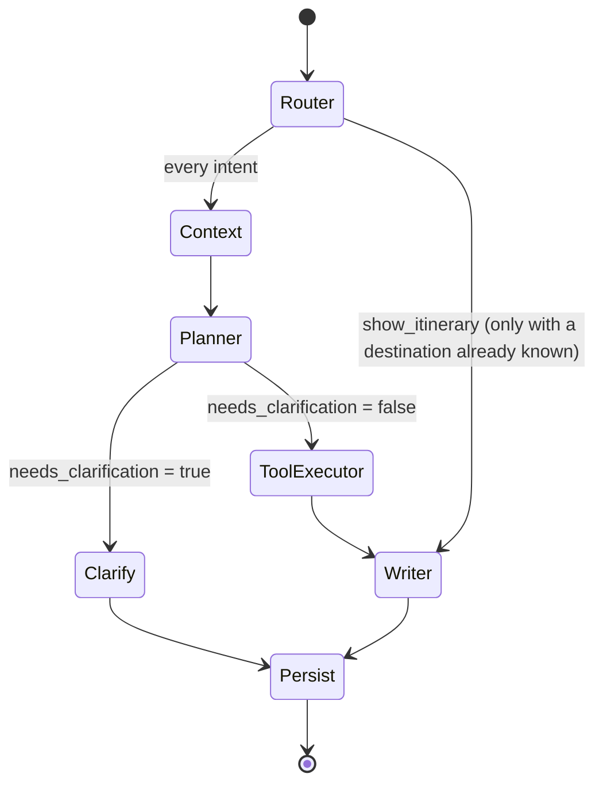
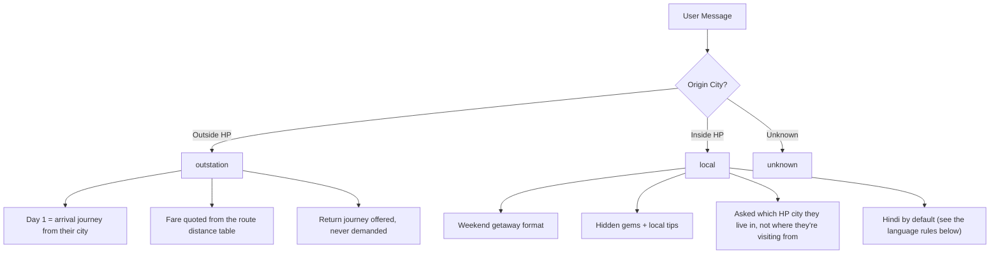
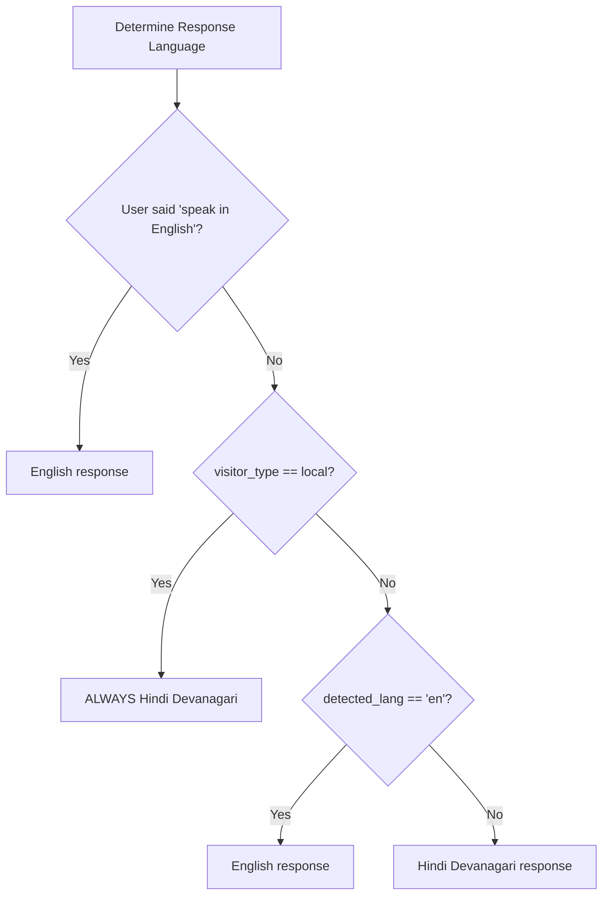

# LangGraph Agent Flow — Him Cab AI Travel Assistant

## Agent Pipeline

The AI agent is implemented as a LangGraph `StateGraph` with 7 nodes and conditional routing.

## What the Agent Asks For — the Slot Policy (`app/agent/slots.py`)

The single source of truth for the information the agent collects: which details
matter for which kind of request, how each is asked, and how a reply is read back.
The LLM extracts facts; **this table decides the conversation**.

| Need | Meaning | Behaviour |
|---|---|---|
| `REQUIRED` | Nothing useful exists without it | Asked until answered. Only `destination` is ever this. |
| `IMPORTANT` | Materially better with it | Asked, but escapable — see the limits below. |
| `OPTIONAL` | Nice to have | Never asked as a question; picked up if the user mentions it. |
| `UNUSED` | Irrelevant to this request | Never asked. |

Policy by intent:

| Intent | Required | Important | Optional |
|---|---|---|---|
| `plan_trip`, `clarification`, `show_itinerary` | destination | origin, duration_days, group_size, travel_dates | return_journey_preference |
| `cost_query` | destination | origin, duration_days, group_size | — |
| `weather_query`, `places_query`, `hotel_query` | destination | — | — |
| `general_query` | — | — | — |

Everything that SHAPES the plan is `IMPORTANT`, so it is collected **before** the plan
is written — and all of it in ONE question, not one per turn. Asking "how many days?"
after handing over an itinerary means the itinerary was written without the answer.

The return cab is `OPTIONAL` because it is a booking detail, not an itinerary input:
it rides along with the closing "shall I book your Him Cab?" instead of gating the plan.

Three independent limits guarantee the conversation terminates:

1. **Per field** — `entities.asked_counts`; one detail is never chased more than
   `settings.max_clarification_attempts` times.
2. **Per person** — `entities.no_progress_turns`; a user who keeps replying without
   answering gets their plan instead of another question. Resets when they engage.
3. **On request** — `entities.proceed_requested`, set when the user says to get on
   with it, in any language (the extraction model detects it).

None of the three can skip `destination`: with no destination there is nothing to
produce, and inventing one is the worst available failure.

Anything the agent proceeds without is returned in `assumed_fields` and stated to
the user as an assumption, at the TOP of the reply where a correction still helps.
**Nothing is ever silently invented.** The reply's closing question is always about
booking, never about a trip detail — see `_build_followup_instruction` in the writer.

Two response shapes, chosen by `slots.response_mode(intent)`:

- `itinerary` — a full day-by-day plan plus the structured JSON (planning intents)
- `answer` — a short direct answer, no itinerary, no JSON (questions about a place)

## Node Descriptions

### 1. Router Node (`router.py`)
- **Model**: Gemini Flash (fast, cheap)
- **Input**: Latest user message
- **Output**: `intent`, `language`, `visitor_type`
- **Intents**: `plan_trip`, `weather_query`, `hotel_query`, `places_query`, `cost_query`, `show_itinerary`, `general_query`, `clarification`

### 2. Context Node (`context.py`)
- **Purpose**: Load long-term user memory from Firestore
- **Input**: `user_id` from state
- **Output**: `user_profile`, `user_context_summary`
- **Notes**: Non-fatal — proceeds without context if Firestore fails

### 3. Planner Node (`planner.py`)
- **Model**: Gemini Flash, structured output (extraction only)
- **Input**: Full conversation history + existing entities + intent
- **Output**: `entities`, `needs_clarification`, `clarification_question`, `visitor_type`,
  `assumed_fields`
- **Key Logic**: the LLM **extracts**, the node **decides**. The model is never asked
  whether to ask a question or what to ask — that is the slot policy above, in code.
  Three guarantees:
  1. A message is read as an answer only to a question we actually asked, and only
     when it parses (`slots.read_answer`). Nothing is inferred from an unrelated message.
  2. The conversation is bounded by the three limits above; it cannot loop.
  3. Whatever it proceeds without is reported in `assumed_fields` for disclosure.
- **Degradation**: if Vertex AI is unavailable, the code-level answer parsers still
  read the reply and the same policy still runs — the agent knows less, behaves the same.

### 4. Clarify Node (`graph.py` inline)
- **Purpose**: Lightweight node that surfaces a clarification question without invoking any LLM
- **Input**: `clarification_question` from Planner
- **Output**: `final_response_text` (the question itself)

### 5. Tool Executor Node (`tool_executor.py`)
- **Purpose**: Call the external services in parallel
- **Tools called** (via `asyncio.gather`):
  - Weather + snowfall risk (OpenWeatherMap; one fetch, risk derived from it)
  - Him Cab fare quote (gated on flag + origin + pricing intent + rider JWT)
- **How a fare gets priced**: `/fare/estimate` is distance-driven, so the route needs a
  distance. Surveyed routes use the measured figure (`himcab/distances.py`); everything
  else is computed from city coordinates (`services/geo.py`) and the fare is labelled
  approximate all the way to the reply. Requiring a surveyed pair is what made most
  itineraries arrive with no price at all.
- **Trip type** is decided by the journey's length, not the rider's persona: a Himachal
  resident driving 270 km is an intercity transfer, not a local run.
- **Timeout**: 20s per tool, graceful degradation on failure — a missing tool result
  costs detail in the reply, never the reply itself

### 6. Writer Node (`writer.py`)
- **Model**: Gemini Flash (streaming on the SSE path, otherwise a single call)
- **Input**: Full state with all tool results, plus `assumed_fields`
- **Output**: `final_response_text`, `structured_itinerary` (JSON), `structured_events` (SSE)
- **Key Logic**: builds the system prompt for the mode the intent calls for. Facts the
  user actually gave are stated as facts; everything the planner could not confirm goes
  in a `DETAILS THE USER NEVER GAVE` block with an explicit instruction — substitute a
  stated default and open by saying so, or work around the gap. An unknown value never
  reaches the model as the literal text `None`, which is what used to invite invention.
- **Live data wins**: after validation, the real cab fare and the real weather report
  are stamped onto the itinerary (`_apply_real_fare`, `_apply_weather`). The model
  used to skip copying the forecast into its JSON, so the app rendered an itinerary
  with no weather even though it had been fetched.

### 7. Persist Node (`persist.py`)
- **Purpose**: Save everything to Firestore
- **Operations**:
  1. Append assistant message to Firestore (atomic)
  2. Update itinerary if generated
  3. Update user profile with trip data
  4. Update extracted entities (including the conversation-control fields)

## Visitor Type Routing

Classification is the extraction model's geography call (`origin_in_himachal`), with
a city list in `planner.py` as the offline fallback — a Himachal town missing from
that list used to send a resident down the outstation flow.

## Language Decision Tree

