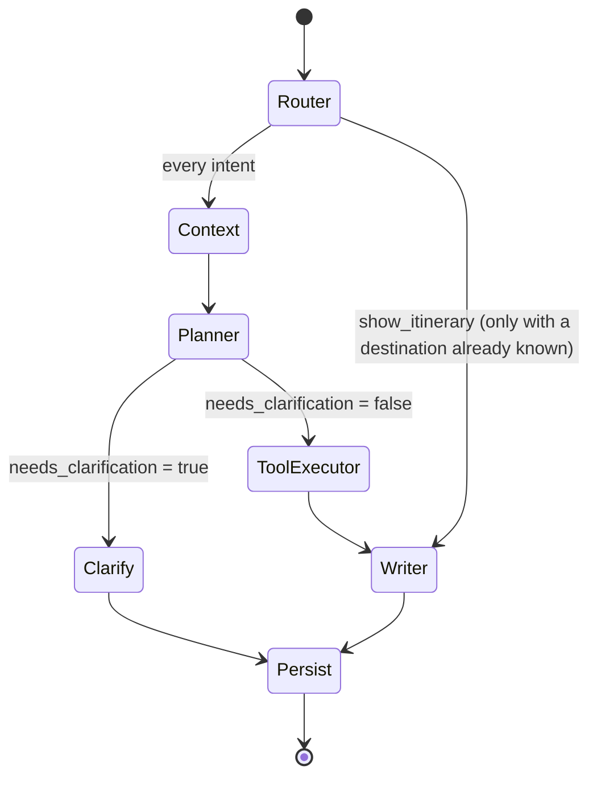
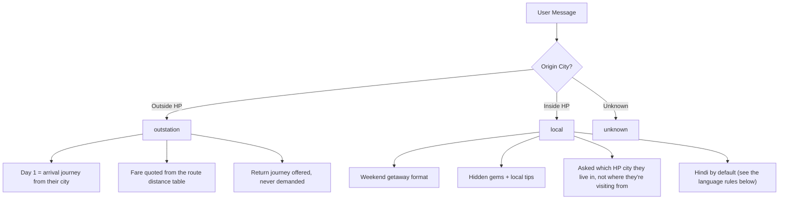
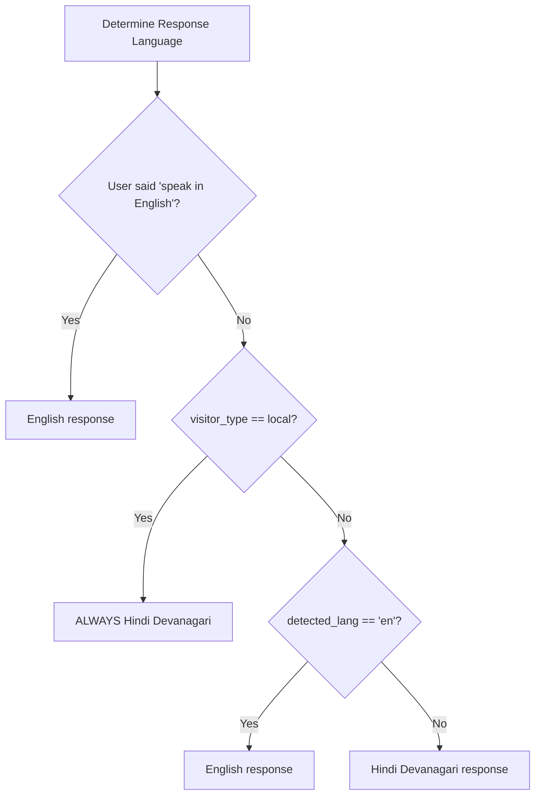

# LangGraph Agent Flow — Him Cab AI Travel Assistant

## Agent Pipeline

The AI agent is implemented as a LangGraph `StateGraph` with 7 nodes and conditional routing.

## What the Agent Asks For — the Slot Policy (`app/agent/slots.py`)

The single source of truth for the information the agent collects: which details
matter for which kind of request, how each is asked, and how a reply is read back.
The LLM extracts facts; **this table decides the conversation**.

| Need | Meaning | Behaviour |
|---|---|---|
| `REQUIRED` | Nothing useful exists without it | Asked until answered. Only `destination` is ever this. |
| `IMPORTANT` | Materially better with it | Asked, but escapable — see the limits below. |
| `OPTIONAL` | Nice to have | Never asked as a question; picked up if the user mentions it. |
| `UNUSED` | Irrelevant to this request | Never asked. |

Policy by intent:

| Intent | Required | Important | Optional |
|---|---|---|---|
| `plan_trip`, `clarification`, `show_itinerary` | destination | origin, duration_days, group_size, travel_dates | return_journey_preference |
| `cost_query` | destination | origin, duration_days, group_size | — |
| `weather_query`, `places_query`, `hotel_query` | destination | — | — |
| `general_query` | — | — | — |

Everything that SHAPES the plan is `IMPORTANT`, so it is collected **before** the plan
is written. Asking "how many days?" after handing over an itinerary means the itinerary
was written without the answer.

Questions are asked **one per turn**, in the order of the table above, so each gets a
focused reply. Bundling them into a single message reads as a form to fill in and
invites a partial answer that has to be chased anyway. A user who volunteers several
details at once still skips those questions — the policy asks for what is *missing*,
it does not run a fixed script.

The return cab is `OPTIONAL` because it is a booking detail, not an itinerary input:
it rides along with the closing "shall I book your Him Cab?" instead of gating the plan.

Three independent limits guarantee the conversation terminates:

1. **Per field** — `entities.asked_counts`; one detail is never chased more than
   `settings.max_clarification_attempts` times.
2. **Per person** — `entities.no_progress_turns`; a user who keeps replying without
   answering gets their plan instead of another question. It counts every turn that
   yields no new detail — deliberately NOT just the turns where a question was asked,
   or giving up would last exactly one turn and the interrogation would restart on
   the next message. Only real progress resets it.
3. **On request** — `entities.proceed_requested`, set when the user says to get on
   with it, in any language (the extraction model detects it).

None of the three can skip `destination`: with no destination there is nothing to
produce, and inventing one is the worst available failure.

Anything the agent proceeds without is returned in `assumed_fields` and stated to
the user as an assumption, at the TOP of the reply where a correction still helps.
**Nothing is ever silently invented.** The reply's closing question is always about
booking, never about a trip detail — see `_build_followup_instruction` in the writer.

Three response shapes, chosen by `slots.response_mode(intent, visitor_type)` — the
same request means different things to the two personas:

| Mode | Who | Reply |
|---|---|---|
| `itinerary` | OUTSTATION visitor, travel intent | Day-by-day plan + structured itinerary JSON, then a `booking_handoff` for the arrival transfer |
| `ride` | LOCAL resident, travel intent | Cab recommendation, fare, drive time, weather, then a `booking_handoff` — no itinerary at all |
| `answer` | either, question about a place | Short direct answer. No trip, no cab, no JSON |

Both travelling modes end on the same hand-off: the plan is of no use to a visitor
until somebody drives them to it. Only `answer` gets none — a question about a place
is not a journey.

`ride` exists because a Kullu resident asking to go to Manali is booking a ride, not
planning a holiday somewhere unfamiliar. Telling them what to see on Mall Road is the
same mistake as answering a weather question with a four-day plan. They are still
asked the same questions — the mode changes the answer, not the interview.

### Which persona, and who decides

Three sources, in increasing authority:

1. **The screen the chat was opened from.** A guess: a Delhi visitor browsing the home
   screen lands on `/local`, and a Shimla resident on the outstation screen lands on
   `/outstation`. Used only when nothing better is available.
2. **The device's GPS fix.** Inside Himachal → `local`, outside → `outstation`
   (`geo.locate` against `geo.HIMACHAL_OUTLINE`, `chat_session.resolve_persona`). This
   overrides the path the app called, and the response says which persona it served.
3. **The rider's own words.** Once they name a starting city, `classify_visitor_type`
   reclassifies from that. Someone who says "I'm coming from Delhi" is a visitor
   whatever their phone reports — they might be booking from anywhere.

A fix that changes the persona mid-conversation carries the conversation across rather
than starting a fresh one (`chat_session._adopt_conversation`). The likeliest way for
that to happen is that the rider has ARRIVED — they planned the trip from Delhi and are
now standing in Manali — and dropping them into an empty chat at that point discards
everything they have already told the assistant.

The reply ends by announcing the booking screen rather than asking whether to book:
the app owns that flow, and `booking_handoff` carries both endpoints **with
coordinates** so its map can drop pins without geocoding the names again. Its
`trip_type` — the rate card the fare was quoted on, decided by the journey's length
rather than by the persona — is how the app keeps a short hop off its outstation
booking screen, which refuses anything inside one state and under 200 km.

## Node Descriptions

### 1. Router Node (`router.py`)
- **Model**: Gemini Flash (fast, cheap)
- **Input**: Latest user message
- **Output**: `intent`, `language`, `visitor_type`
- **Intents**: `plan_trip`, `weather_query`, `hotel_query`, `places_query`, `cost_query`, `show_itinerary`, `general_query`, `clarification`

### 2. Context Node (`context.py`)
- **Purpose**: Load long-term user memory from Firestore
- **Input**: `user_id` from state
- **Output**: `user_profile`, `user_context_summary`
- **Notes**: Non-fatal — proceeds without context if Firestore fails

### 3. Planner Node (`planner.py`)
- **Model**: Gemini Flash, structured output (extraction only)
- **Input**: Full conversation history + existing entities + intent
- **Output**: `entities`, `needs_clarification`, `clarification_question`, `visitor_type`,
  `assumed_fields`
- **Key Logic**: the LLM **extracts**, the node **decides**. The model is never asked
  whether to ask a question or what to ask — that is the slot policy above, in code.
  Three guarantees:
  1. A message is read as an answer only to a question we actually asked, and only
     when it parses (`slots.read_answer`). Nothing is inferred from an unrelated message.
  2. The conversation is bounded by the three limits above; it cannot loop.
  3. Whatever it proceeds without is reported in `assumed_fields` for disclosure.
- **Degradation**: if Vertex AI is unavailable, the code-level answer parsers still
  read the reply and the same policy still runs — the agent knows less, behaves the same.

### 4. Clarify Node (`graph.py` inline)
- **Purpose**: Lightweight node that surfaces a clarification question without invoking any LLM
- **Input**: `clarification_question` from Planner
- **Output**: `final_response_text` (the question itself)

### 5. Tool Executor Node (`tool_executor.py`)
- **Purpose**: Call the external services, in parallel where they are independent
- **Tools called**:
  - Weather + snowfall risk (OpenWeatherMap; one fetch, risk derived from it)
  - Him Cab fare quote (gated on flag + a pickup point + pricing intent + rider JWT)
  - Him Cab offers (gated on flag + pricing intent + rider JWT)
- **Order**: the route is resolved first, in memory; weather and the fare then run
  concurrently; offers follow the fare. That order is forced by the data — the fare
  needs the distance, and whether a coupon applies depends on the fare.
- **Where the journey is measured from**: the rider's own GPS fix when the app sent one
  and they have not named a different origin (`tool_executor._resolve_journey`). A fix
  within `geo.PRECISE_FIX_KM` (15 km) of the town the geocoder names is close enough to
  call that town their pickup out loud; beyond that the coordinates still measure the
  journey but the name is only the nearest thing the provider could point at, because
  "Manali" and a point 30 km down the Kullu road are not the same journey. Falls back to
  city-to-city when there is no fix.
- **How a fare gets priced**: `/fare/estimate` is distance-driven, so the route needs a
  distance. There is no table of surveyed routes any more — the distance and the drive
  time come from a routing engine over the real road graph
  (`app/integrations/external/routing.py`), composed into a `Journey` by
  `app/services/geo.py`, with place names resolved by
  `app/integrations/external/geocoding.py`. When the engine finds no road, the journey
  is None and no fare is quoted at all: the reply says the fare is confirmed at booking
  rather than inventing one. `bookingTime` is the rider's clock in IST, so the
  night-charge window is the same one the booking will be priced in.
- **Which cabs are offered**: the endpoint prices EVERY category, so the raw list always
  includes vehicles the group cannot sensibly book. `himcab/vehicles.py` narrows it to
  what seats them, smallest suitable first — repeating the backend's list verbatim is
  how a party of four was recommended a Mini Bus. Seat counts come from the response
  when present and from the category name otherwise.
- **Which coupons are offered**: only ones the backend returned, filtered to this trip
  type, today's date and the quoted fare, best saving first, capped at
  `MAX_OFFERS_IN_REPLY`. The saving is computed here, not by the model — the rider will
  check it against their receipt.
- **Trip type** is decided by the journey's length, not the rider's persona: a Himachal
  resident driving 270 km is an intercity transfer, not a local run.
- **Timeout**: 20s per tool, graceful degradation on failure — a missing tool result
  costs detail in the reply, never the reply itself

### 6. Writer Node (`writer.py`)
- **Model**: Gemini Flash (streaming on the SSE path, otherwise a single call)
- **Input**: Full state with all tool results, plus `assumed_fields`
- **Output**: `final_response_text`, `structured_itinerary` (JSON), `structured_events` (SSE)
- **Key Logic**: builds the system prompt for the mode the intent calls for. Facts the
  user actually gave are stated as facts; everything the planner could not confirm goes
  in a `DETAILS THE USER NEVER GAVE` block with an explicit instruction — substitute a
  stated default and open by saying so, or work around the gap. An unknown value never
  reaches the model as the literal text `None`, which is what used to invite invention.
- **Live data wins**: after validation, the real cab fare, the real weather report and
  the measured journey are stamped onto the itinerary (`_apply_real_fare`,
  `_apply_weather`, `_apply_travel_info`). The model used to skip copying the forecast
  into its JSON, so the app rendered an itinerary with no weather even though it had
  been fetched — and `travel_info` shipped with both distance and duration null even
  when the route was known.
- **Coupons**: the prompt carries either the real ones (`_build_offers_block`, quoted
  verbatim with their exact codes and savings) or a flat ban on mentioning discounts —
  never both. The blanket ban was right while nothing supplied real offers; keeping it
  afterwards would mean a rider pays full price with a valid coupon in their account.

### 7. Persist Node (`persist.py`)
- **Purpose**: Save everything to Firestore
- **Operations**:
  1. Append assistant message to Firestore (atomic)
  2. Update itinerary if generated
  3. Update user profile with trip data
  4. Update extracted entities (including the conversation-control fields)

## Visitor Type Routing

Classification is the extraction model's geography call (`origin_in_himachal`), with
a city list in `planner.py` as the offline fallback — a Himachal town missing from
that list used to send a resident down the outstation flow.

## Language Decision Tree

