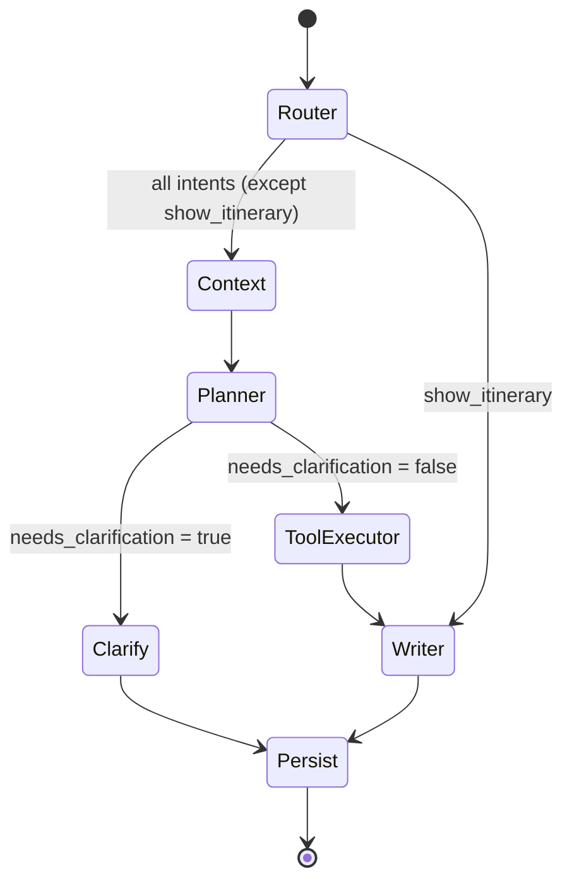
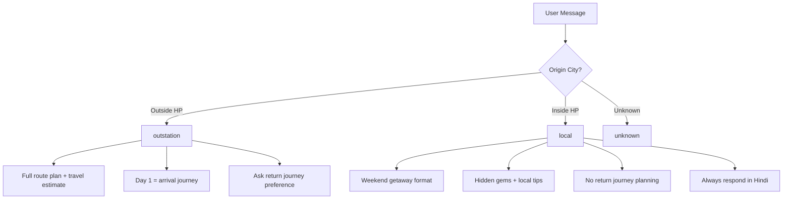
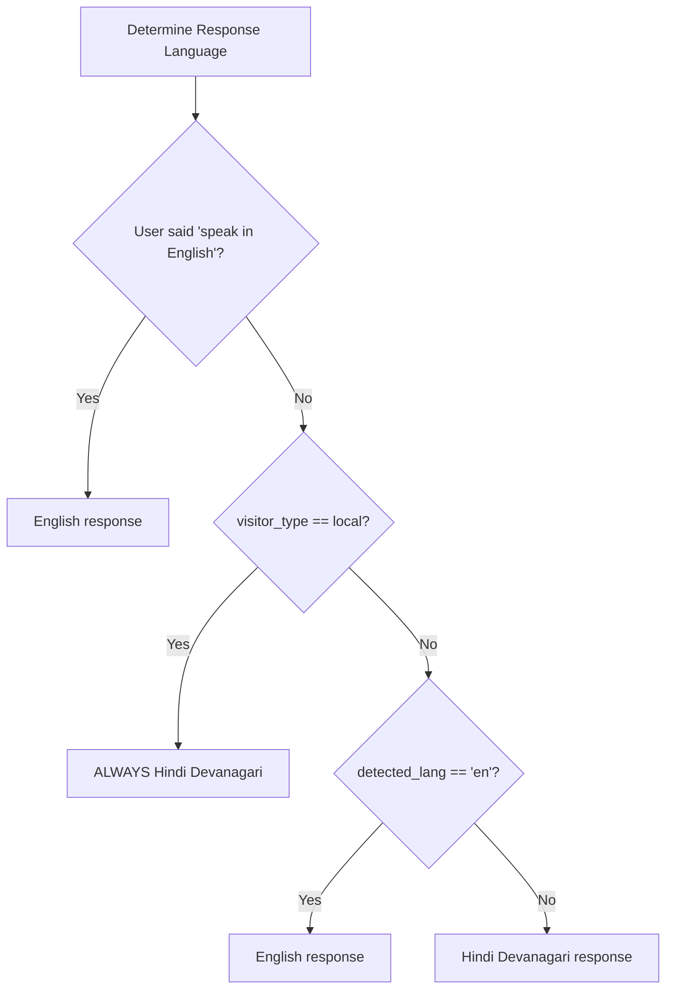

# LangGraph Agent Flow — Him Cab AI Travel Assistant

## Agent Pipeline

The AI agent is implemented as a LangGraph `StateGraph` with 7 nodes and conditional routing.

## Node Descriptions

### 1. Router Node (`router.py`)
- **Model**: Gemini Flash (fast, cheap)
- **Input**: Latest user message
- **Output**: `intent`, `language`, `visitor_type`
- **Intents**: `plan_trip`, `weather_query`, `hotel_query`, `places_query`, `cost_query`, `show_itinerary`, `general_query`, `clarification`

### 2. Context Node (`context.py`)
- **Purpose**: Load long-term user memory from Firestore
- **Input**: `user_id` from state
- **Output**: `user_profile`, `user_context_summary`, `is_frequent_traveller`
- **Notes**: Non-fatal — proceeds without context if Firestore fails

### 3. Planner Node (`planner.py`)
- **Model**: Gemini Pro (complex reasoning)
- **Input**: Full conversation history + existing entities
- **Output**: `entities` (ExtractedEntities), `needs_clarification`, `clarification_question`, `visitor_type`
- **Key Logic**: Progressive entity extraction with priority-ordered clarification questions

### 4. Clarify Node (`graph.py` inline)
- **Purpose**: Lightweight node that surfaces a clarification question without invoking any LLM
- **Input**: `clarification_question` from Planner
- **Output**: `final_response_text` (the question itself)

### 5. Tool Executor Node (`tool_executor.py`)
- **Purpose**: Call all external APIs in parallel
- **Tools called** (via `asyncio.gather`):
  - Weather (OpenWeatherMap)
  - Snowfall risk
  - Places/POIs (Overpass API — currently disabled)
  - Drive times (hardcoded table)
  - Offers (local compute, ~0ms)
  - Booking API (Java backend, conditional)
- **Timeout**: 20s per tool, graceful degradation on failure

### 6. Writer Node (`writer.py`)
- **Model**: Gemini Flash (non-streaming invocation)
- **Input**: Full state with all tool results
- **Output**: `final_response_text`, `structured_itinerary` (JSON), `structured_events` (SSE)
- **Key Logic**: Builds a rich system prompt with weather, places, route, offers data; generates both natural language and structured JSON

### 7. Persist Node (`persist.py`)
- **Purpose**: Save everything to Firestore + invalidate Redis cache
- **Operations**:
  1. Append assistant message to Firestore (atomic)
  2. Update itinerary if generated
  3. Update user profile with trip data
  4. Update extracted entities
  5. Invalidate Redis session cache

## Visitor Type Routing

## Language Decision Tree

