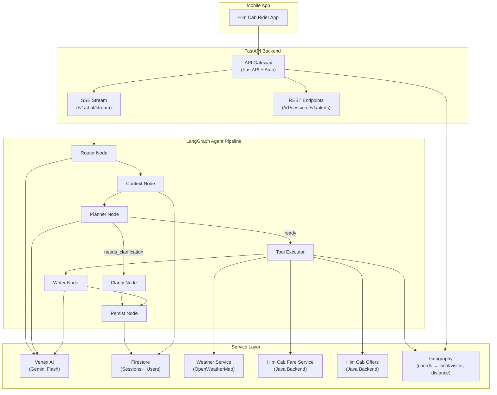
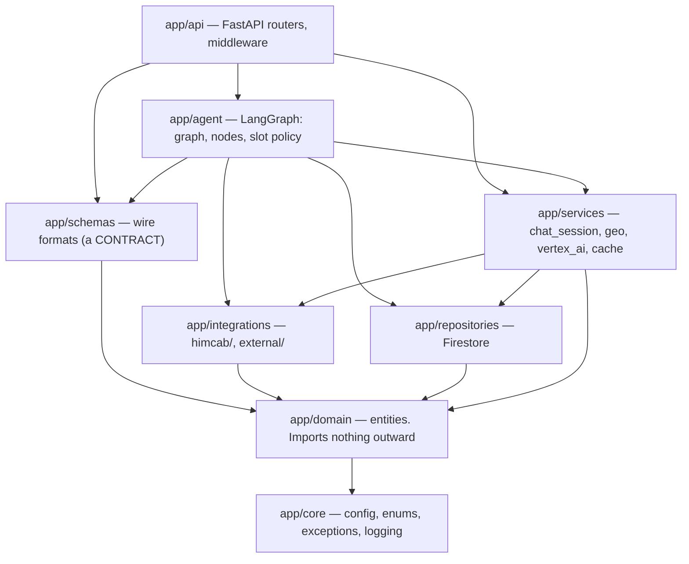
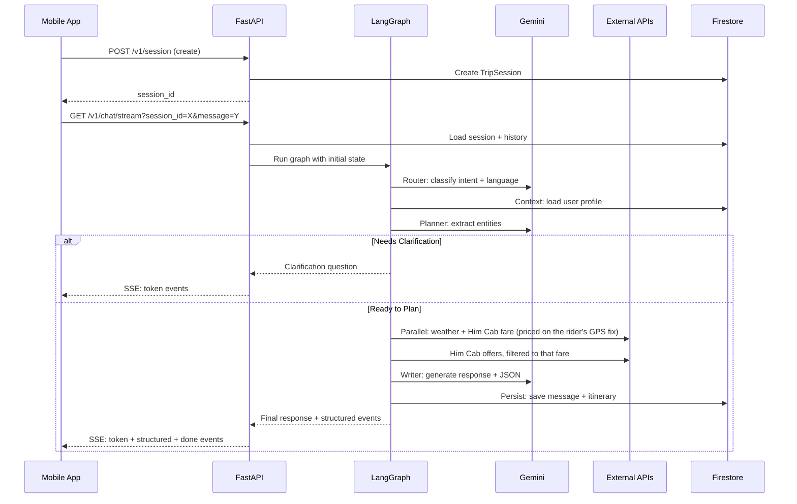

# Him Cab AI Travel Assistant — System Architecture

## Overview

The Him Cab AI Travel Assistant is an enterprise-grade, LangGraph-powered conversational AI backend
that plans Himachal Pradesh trips, generates structured itineraries, and integrates with the
Him Cab rider app for end-to-end cab booking.

## High-Level Architecture

## Package Layering

The packages under `app/` are ordered, and the order is enforced by
`tests/unit/test_architecture.py` rather than left to good intentions. Each layer may
import the ones below it and never the ones above.

| Layer | Holds | May not import |
|---|---|---|
| `domain/` | Entities: `TripSession`, `Itinerary`, `UserProfile`, `RiderLocation`, `WeatherReport` | anything except `core` |
| `schemas/` | Request/response bodies, `StructuredEvent` | `api`, `agent`, `services`, `integrations`, `repositories` |
| `repositories/` | Firestore session + profile stores | `api`, `schemas`, `agent` |
| `integrations/` | HTTP clients: Him Cab backend, geocoding, routing, weather | `api`, `schemas`, `agent` |
| `services/` | Application logic that is neither entity nor I/O client | `api` |
| `agent/` | The LangGraph pipeline and the conversation policy | `api` |
| `api/` | Delivery. Nothing imports this | — |

**Why `schemas` and `domain` are separate.** They were one file. A field added so the
app could render something kept becoming a field that was persisted, and a field the
agent needed kept leaking into the public API shape. They change for different reasons
and at different costs: an entity can be refactored whenever the code needs it, while
renaming a field in `schemas/` breaks every shipped mobile build that has not updated.

**Why no web framework below `api/`.** A test asserts that `domain`, `integrations`,
`repositories` and `agent` import neither `fastapi` nor `starlette`. The graph has to
be runnable from a test, a script or a queue worker — not only from inside a request.

**What this caught.** `RiderLocation` — an entity — had a `resolve()` classmethod that
called the geocoder, so `app/domain` depended on an HTTP client and the model could not
be constructed or reasoned about without a network. The lookup moved to
`geo.resolve_rider_location()`; the entity kept the data and the one rule that is about
the data rather than about fetching it (`PRECISE_FIX_KM`).

## Data Flow

## Infrastructure (GCP)

| Component | GCP Service | Purpose |
|-----------|------------|---------|
| API Server | Cloud Run | Auto-scaling containerized backend |
| Database | Firestore | Session + user profile persistence — the only stateful dependency |
| AI Models | Vertex AI (Gemini) | LLM inference |
| Auth | Firebase Auth | JWT-based user authentication |
| Secrets | Secret Manager | API keys, credentials |
| Container Registry | Artifact Registry | Docker images |

## Key Design Decisions

1. **LangGraph over raw LangChain**: Provides stateful, graph-based agent execution with clear node boundaries and conditional routing.

2. **Flash everywhere**: routing and extraction are classification tasks and the writer is latency-critical, so all three use Gemini Flash. A Pro client was being constructed at startup and never called.

3. **Firestore only, no cache tier**: caching and rate limiting are in-process (`app/services/local_cache.py`). The cache held a conversation pointer that Firestore already mirrored, an alerts response, and a request counter — none worth an external dependency that could be down. The trade is that the rate limit is per instance; see `docs/api_reference.md`.

4. **Parallel tool execution**: external calls run concurrently via `asyncio.gather()` — total latency = slowest single call, not their sum.

5. **The conversation policy lives in code, not in a prompt**: `app/agent/slots.py` decides what to ask and when; the LLM only extracts what the user said. Letting the model own the flow produced questions in the wrong language, for details already given, and for details the request never needed.

6. **Live data overrides generated data**: the real fare, the real weather report and the measured journey are stamped onto the itinerary after validation, so a price, a forecast or a distance can never be something the model invented — or something it forgot to include. Coupons are the same rule stated the other way: the reply may quote only the codes the backend returned, and when there are none it is forbidden to mention discounts at all.

7. **Coordinates decide the persona, the conversation corrects it**: a GPS fix inside Himachal serves the local assistant and one outside serves the outstation assistant (`app/services/geo.py`, `POST /v1/chat/route`) — a better answer than which screen the chat bubble was tapped from. The fix also supplies the pickup point, so the fare is priced from where the rider actually is instead of a city centroid, and a rider who never types their city out still gets a price. Whatever they say about their origin still outranks it.

8. **SSE streaming**: Token-by-token streaming for chat UX, with structured JSON events for mobile card rendering.

9. **Prompt templates in YAML**: Prompts are the most iterated component — extracting them into versioned YAML templates enables prompt engineering without code changes.
