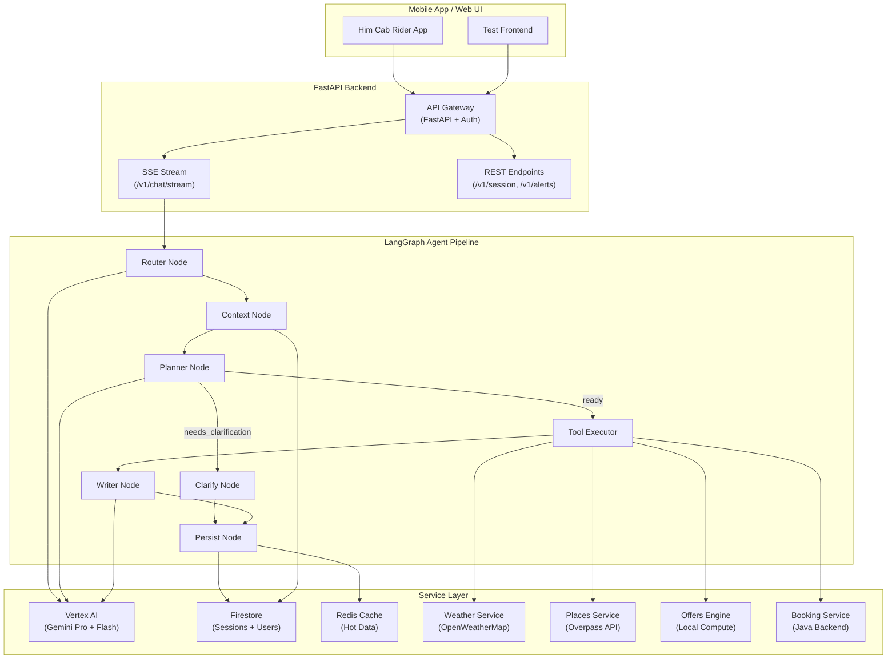
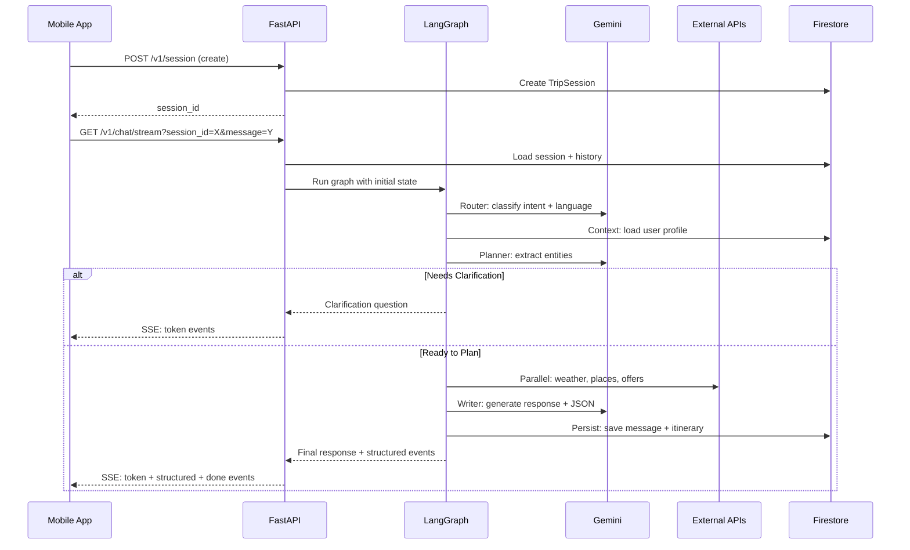

# Him Cab AI Travel Assistant — System Architecture

## Overview

The Him Cab AI Travel Assistant is an enterprise-grade, LangGraph-powered conversational AI backend
that plans Himachal Pradesh trips, generates structured itineraries, and integrates with the
Him Cab rider app for end-to-end cab booking.

## High-Level Architecture

## Data Flow

## Infrastructure (GCP)

| Component | GCP Service | Purpose |
|-----------|------------|---------|
| API Server | Cloud Run | Auto-scaling containerized backend |
| Database | Firestore | Session + user profile persistence |
| Cache | Memorystore (Redis) | Hot cache, rate limiting |
| AI Models | Vertex AI (Gemini) | LLM inference |
| Auth | Firebase Auth | JWT-based user authentication |
| Secrets | Secret Manager | API keys, credentials |
| Container Registry | Artifact Registry | Docker images |
| Scheduler | Cloud Scheduler | Alert refresh jobs |

## Key Design Decisions

1. **LangGraph over raw LangChain**: Provides stateful, graph-based agent execution with clear node boundaries and conditional routing.

2. **Gemini Pro for planning, Flash for writing**: Pro handles complex JSON extraction (planner), Flash handles fast response generation (writer, router).

3. **Redis as hot cache, Firestore as cold store**: Redis for sub-second reads (weather, places, sessions), Firestore for durable persistence.

4. **Parallel tool execution**: All external API calls (`weather`, `places`, `offers`) run concurrently via `asyncio.gather()` — total latency = slowest single call.

5. **SSE streaming**: Token-by-token streaming for chat UX, with structured JSON events for mobile card rendering.

6. **Prompt templates in YAML**: Prompts are the most iterated component — extracting them into versioned YAML templates enables prompt engineering without code changes.
